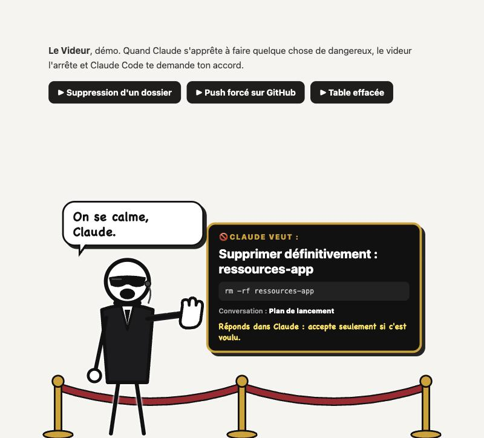
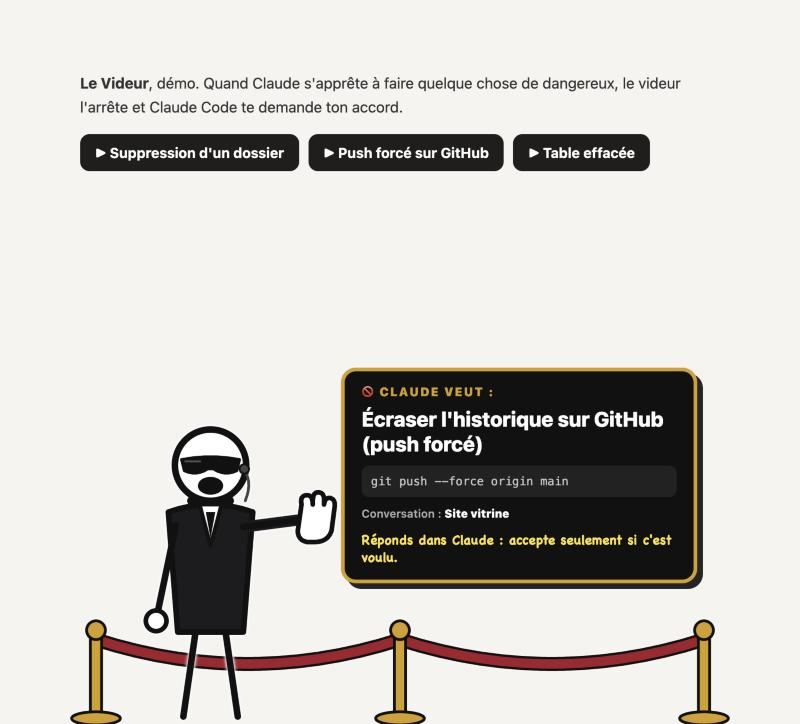

# Le Videur 🕶️

En mode « Ignorer les permissions », Claude Code lance toutes ses commandes sans te demander. C'est rapide… jusqu'au jour où il efface un dossier ou écrase ton travail sur GitHub.

**Le Videur** garde l'entrée : quand Claude s'apprête à faire quelque chose de dangereux, un videur en costume noir surgit à l'écran, bras tendu (« Halte ! »), devant une corde de boîte de nuit. Une fiche montre en clair ce que Claude veut faire, et Claude Code **te demande ton accord**, même en mode « Ignorer les permissions ». Tu acceptes ou tu refuses.

Pour tout le reste, il ne dit rien.

<p align="center">
  
  
</p>

▶ **[Voir la démo dans ton navigateur](https://pablitooo5.github.io/le-videur/demo.html)**

---

## Installer (Mac)

Ouvre l'app **Terminal** et colle cette ligne :

```bash
curl -fsSL https://raw.githubusercontent.com/Pablitooo5/le-videur/main/install.sh | bash
```

Ensuite, clique sur l'icône **🕶️** dans la barre des menus, puis sur **Lancer la démo**.

**Il te faut :** un Mac avec macOS 14 ou plus récent, **Claude Code** (onglet *Code* de l'app Claude, ou terminal), et les outils de développement d'Apple (`xcode-select --install` si l'installation te le demande).

## Ce qu'il arrête

| Claude veut… | Exemple |
| --- | --- |
| Supprimer un dossier entier | `rm -rf ressources-app` |
| Écraser l'historique sur GitHub | `git push --force` |
| Effacer tes modifications en cours | `git reset --hard`, `git checkout -- .`, `git clean -f` |
| Supprimer une branche | `git branch -D`, `git push --delete` |
| Effacer des données d'une base | `DROP TABLE`, `TRUNCATE`, `DELETE` sans condition |
| Supprimer en masse | `find … -delete`, `xargs rm` |
| Exécuter un script téléchargé | `curl … \| bash` |
| Agir en administrateur | `sudo …` |
| Effacer un disque | `diskutil erase…`, `dd of=/dev/…` |
| Publier ou supprimer en ligne | `npm publish`, `gh repo delete`, `supabase db reset` |
| Modifier un fichier hors du projet | `~/.zshrc`, `~/.ssh/…`, tes réglages |
| Utiliser un outil connecté qui supprime | suppression d'e-mails, de projets, de branches… |
| Désactiver le Videur lui-même | écrire dans `~/.claude/videur` |

## Ce qu'il laisse passer

Tout le travail normal : lire et modifier les fichiers du projet, `npm install`, `npm run build`, `git push` normal, `rm` d'un fichier, et le nettoyage des dossiers générés (`node_modules`, `dist`, `build`, `.next`, caches, fichiers temporaires).

## Le menu 🕶️

- **Lancer la démo**
- **Protection active** : décocher la désactive (il te demande confirmation, et l'icône devient 😴)
- **Son**
- **Quitter** : la protection reste active même si l'app est fermée. Seule l'animation disparaît.

## Comment ça marche

Avant chaque action de Claude, un *hook* Claude Code (`PreToolUse`) lance `videur.py`. Si l'action est dangereuse, il répond à Claude Code « demande l'accord » et l'app fait apparaître le videur. Chaque vérification prend environ un dixième de seconde. Rien n'est envoyé sur Internet.

C'est un garde-fou contre les accidents, pas une protection absolue : une commande dangereuse rangée dans un script peut passer.

## Désinstaller

```bash
~/.claude/videur/uninstall.sh
```

## À savoir

Projet perso et non officiel, sans lien avec Anthropic. « Claude » et « Claude Code » sont des marques d'Anthropic. Licence MIT.

Du même auteur :
- [Toc Toc](https://github.com/Pablitooo5/toc-toc) : un mini Claude vient toquer à ton écran quand Claude t'a répondu et que tu ne regardes pas.
- [Écran Cassé](https://github.com/Pablitooo5/ecran-casse) : un bonhomme casse ton écran quand Claude t'a répondu et que tu scrolles sur ton téléphone.
- [Alerte Contexte](https://github.com/Pablitooo5/alerte-contexte) : un chef de chantier passe avec une pancarte quand ta conversation devient trop lourde.
- [Travail Terminé](https://github.com/Pablitooo5/travail-termine) : un mini personnage sort en bas à gauche avec une pancarte quand Claude finit une tâche.
